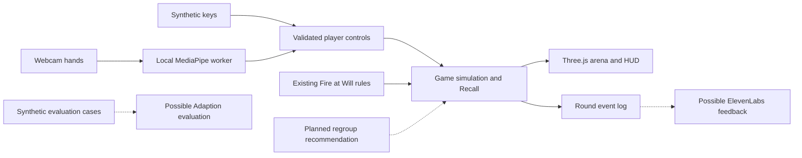

# StarshipMania team plan

## First playable demo

While the pilot steers, one in-game drone recommends regrouping and shows one clear reason. The pilot can accept or dismiss. Recall takes priority and clears any pending acceptance. Use one local rule and a repeatable Synthetic Rehearsal scenario.

At scope lock, give everyone two minutes to propose the trigger. Compare separation from the pilot and a blocked route on player value, explainability and repeatability. Boyong breaks ties. Write down the trigger and its threshold or condition, the exact demo input, the result of accept, dismiss and Recall, and which files each person owns. Agree the HUD inputs and callbacks before the two coders begin. Keep this decision in the team task and tell Control Tower which milestone it unlocks.

| Owner | First deliverable |
| --- | --- |
| **Boyong · manager and main coder** | Own gameplay, shared wiring and merges. Integrate the rule and HUD. Preserve existing steering and manual Recall. |
| **UI coder · name pending** | Use Figma Make with example data. Design pending, accepted, dismissed and recalled states. Share the prototype link, then port one keyboard-accessible HUD panel in a focused PR. |
| **Gameplay helper · name pending** | Implement the selected regroup rule and focused tests in an isolated module with an agreed interface. Boyong integrates the module. |
| **QA and demo · name pending** | Run the game from a clean checkout, review the exact revision independently, and own the two-minute recording and backup. |

Each teammate gives Boyong one relevant example of work, availability, and whether they can access GitHub, open the agreed tools and run the game. Pair on the first setup if needed. Assign one writer to shared code. Boyong owns changes to the input wiring and simulation loop.

## Programme · London time

| Target | Outcome |
| --- | --- |
| Sat 15:45–16:05 | Agree demo trigger and acceptance criteria. Confirm access, files and owners. Review the readiness PR before branching if time permits. |
| Sat 16:05–17:45 | Build the rule and HUD in parallel. QA writes repeatable demo steps. The gameplay helper runs a separate 20-minute ElevenLabs research check by 16:25. |
| Sat 17:45–19:00 | Integrate and run a full scenario. If late, trim to one readable panel and keep Recall and recording time. |
| Sat 19:45–20:45 | Fix blocking issues and record a backup on the known-good build. |
| Sun 10:00 | Freeze and rehearse clean `main`. Verify the video and links. |
| Sun 11:00 | Boyong submits and checks the receipt if the entry package is ready. |
| Sun 12:00 | Official submission cutoff. [Event rules](https://imperial-ai-hackathon.devpost.com/rules) |

## Role actions and agent prompts

Start with your role below. The times are London working targets. If your task depends on the design decision, inspect the baseline and prepare test cases while Boyong locks the trigger.

### 1. Boyong · Manager and main coder

**Start now** · Open StarshipMania in Codex. Give everyone 20 minutes to agree the trigger, demo input and who edits each file.

- **15:45–16:05** · Choose one trigger. Agree what Accept, Dismiss and Recall do. Post the HUD state/actions and reproducible arena setup for Roles 2–4.
- **16:05–17:15** · Own the wiring in main.ts and simulation.ts. Create the integration branch. Make Recall clear the proposed action and invalidate stale acceptance.
- **17:15–19:00** · Review the rule and HUD PRs. Integrate and run the full flow with QA. At 17:45, cut extras if it cannot be played end to end.
- **Sun 10:00–11:00** · Freeze, verify the reviewed commit and submission links, then submit and check the receipt.

**Handoff** · Scope decision and file boundaries → merged playable commit and QA evidence.

**Copy into your agent**

> Read AGENTS.md and the team guide in draft PR #1. Inspect the current simulation, Recall and input flow. First propose the smallest interface between a local regroup rule, the HUD and the game, with the files each teammate owns. Wait for my trigger and scope decision. Then work on codex/boyong-integration, wire the agreed interfaces and test that Recall clears a pending or accepted recommendation and beats a stale acceptance. Keep steering working. Show the diff and checks and stop before pushing.

### 2. Figma Make / UI coder · Prototype and HUD PR

**Start now** · Open Figma Make with sample data. Sketch one small HUD panel for a drone recommendation, its reason and the pilot’s choices.

- **15:45–16:05** · Draft pending, accepted, dismissed and recalled states with fake data. Agree the labels and actions with Boyong.
- **16:05–17:15** · Open your own StarshipMania checkout in Codex or Claude Code. Port the agreed panel and styles. Keep keyboard access and avoid stealing focus while steering.
- **17:15–17:45** · Run the build and check UI states. Push the UI branch and open a PR with the Figma link, a screenshot and exact browser steps.
- **17:45–19:00** · Pair with Boyong and QA to check the HUD on the integrated branch. Fix only issues that affect the demo.

**Handoff** · Figma Make prototype → focused HUD PR and keyboard/browser check.

**Copy into your agent**

> Read AGENTS.md and the team guide in draft PR #1. I own the recommendation HUD on codex/ui-hud. Use my Figma Make design and the agreed example states. Propose a small renderer and styles with Accept and Dismiss buttons and a visible reason. Keep changes inside the files Boyong assigns. Send shared wiring requests to Boyong. Run the build, list the checks I should make in Synthetic Rehearsal and show the diff before I commit.

### 3. Gameplay helper · Drone rule and ElevenLabs research

**Start now** · Open your own StarshipMania checkout. Use a build chat for the drone rule and a separate read-only chat for a 20-minute ElevenLabs check.

- **15:45–16:05** · Compare triggers with the team. Get the agreed inputs, threshold or condition and reason text from Boyong.
- **16:05–16:25** · Start the ElevenLabs research prompt. Return a short go/no-go with access, integration effort and fallback while keeping the rule as the first coding task.
- **16:05–17:15** · Build the local rule in an isolated TypeScript module. Add focused tests for a trigger, no trigger and an invalid or stale input if the agreed interface permits it.
- **17:15–17:45** · Open the rule PR with the inputs, output example and test command. Help QA reproduce the trigger. Live voice is a separate task only after core QA passes.

**Handoff** · Tested local recommendation PR → brief voice feasibility note for Boyong.

**Copy into your agent**

> Read AGENTS.md and the team guide in draft PR #1. On codex/gameplay-regroup, implement only the agreed local regroup decision and its focused tests. Given a small game-state snapshot, return one recommendation and reason or return none. Keep the rule independent from the HUD, microphone and game loop. Do not send player commands or integrate a model. Show the passing cases, changed files and test command before I commit.

**Copy into a separate research chat**

> Read official ElevenLabs docs for Realtime Agents, client tools and authentication. In 20 minutes, recommend spoken explanation first or a two-way voice experiment later. Report confirmed team access or unknown, where it would connect to the game, what permissions and server-side auth it needs, and a rough time estimate. Treat accept/dismiss as proposed actions validated locally, keep Recall and keyboard fallback local, and keep secrets out of the browser. Return go/no-go with source links. Research only.

[ElevenLabs client tools](https://elevenlabs.io/docs/eleven-agents/customization/tools/client-tools) · [Agent authentication](https://elevenlabs.io/docs/eleven-agents/customization/authentication)

### 4. Independent QA · Feature checks and demo

**Start now** · Clone the game on your machine. Ask your agent to help you run the baseline and write a checklist you can follow yourself.

- **15:45–16:15** · Run clean Synthetic Rehearsal and record the baseline commit. Draft a repeatable test for steering, trigger, Accept, Dismiss, pending Recall, accepted Recall and Retry.
- **17:15–17:45** · Review the rule and HUD PRs. Run the exact revision when available and report the commit, expected outcome, actual outcome and any blocker.
- **17:45–19:00** · Play the integrated flow independently. Check stale acceptance after Recall and that the demo works without camera, mic or sponsor credentials.
- **19:45–20:45 / Sun 10:00** · Record a two-minute backup from the last verified build. Rehearse after freeze and verify the judge-facing links.

**Handoff** · Pass/fail results on an exact commit → short demo and backup recording.

**Copy into your agent**

> Read AGENTS.md and the team guide in draft PR #1. Help me check a clean checkout in Synthetic Rehearsal. Give me the exact commands and browser steps. On the reviewed commit check steering during the recommendation, Accept, Dismiss, Recall pending and after acceptance, stale acceptance and Retry. Keep the camera off. Record commit, steps, expected and actual behaviour and known failures. Review and report only. Do not edit or merge.

## From a first change to a merge

### 1. Run the game

Install Git and Node.js 24 if needed, sign into GitHub, then use PowerShell. Each teammate runs their own preview.

```powershell
git clone https://github.com/Capitano00/StarshipMania.git
cd StarshipMania
npm.cmd ci --ignore-scripts
npm.cmd run build
npm.cmd run preview
```

Open [http://127.0.0.1:4180/](http://127.0.0.1:4180/). Choose **Synthetic Rehearsal**, **Check both hands**, then **Test controls** or **Enter arena** and follow the on-screen instructions. Use `Ctrl+C` in the preview terminal before restarting it. In regular testing, keep the camera off. If a tooling permission error prevents tests from starting inside Codex, try the same command in normal PowerShell.

### 2. Take a small task

Boyong supplies the visible outcome, expected behaviour and files the author may edit. Review the existing readiness PR together before starting if time permits. If it is still pending at build time, branch from current `main` and hold the readiness PR until after integration. Open the guide from PR #1 in GitHub if it is not in your checkout yet.

```powershell
git switch main
git pull --ff-only
git switch -c codex/name-task
```

Replace `name-task` with your name and task. Give Codex or Claude Code these instructions in your checkout:

> Read AGENTS.md and the team guide, which is linked in PR #1. Work on this branch. Task: [one visible change]. Edit only [agreed files]. Show the diff, run the build and relevant checks, and explain what I should verify in the browser. Stop before committing if any check fails or a shared interface must change.

Use one assistant as writer per branch. The UI owner can use Figma Make to experiment with mock states, then port the approved panel into the existing game. Boyong handles the shared wiring. Keep credentials, recordings, camera captures and model files out of the repository.

### 3. Review, save and share

Run `git status --short` and `git diff`. Check the actual code, then run `npm.cmd run build`, `npm.cmd test -- tests/v043.test.ts` for the existing control regression case, any directly affected tests, and the browser scenario. PR #1 recorded the same 71 inherited failures on base and candidate. For a full-suite comparison, compare failure names and investigate new or changed failures.

```powershell
git add -- path/to/changed-file
git diff --cached
git commit -m "Describe the visible change"
git push -u origin HEAD
```

Replace the sample file path with the actual files. A commit saves a local checkpoint. Pushing uploads the branch. Open a pull request against `main` on GitHub and include the outcome, changed files, exact run steps, test results, known limitations and whether the project code map is affected. The team pushes task branches and uses PRs for changes to `main`.

### 4. Review again and verify the merged game

A second person opens **Files changed** and checks that the change matches the task. Run the PR in a clean review checkout using the exact commit shown in the PR. For example, for PR 1, ensure the checkout is clean first, then run `git fetch origin refs/pull/1/head`, `git switch --detach FETCH_HEAD` and `git rev-parse --short HEAD`. Verify the commit and repeat the install if the lockfile changed. Build and play the change. Report a failure with steps, expected result and actual result. The author fixes it on the same branch and asks for another review after pushing. A teammate also reviews Boyong’s changes.

Boyong uses **Squash and merge** after independent review. QA switches back to `main`, runs `git pull --ff-only`, rebuilds and repeats the demo on the merged commit. If it regresses, Boyong uses the last verified build for rehearsal and prepares a revert PR.

### Demo acceptance

- Move while the recommendation and reason appear.
- Accept and observe the agreed regroup outcome. In a fresh run, dismiss and verify the recommendation does not issue an order.
- Press **R** with the recommendation pending and again after acceptance in a separate run. Recall takes priority. A stale acceptance cannot reactivate the recommendation.
- Retry clears the previous recommendation. The full sequence works with the camera off and no sponsor credentials.
- Record the tested commit, steps, expected and actual results. Check that the judge-facing code and video links open and that Devpost shows a receipt once Boyong submits. Preserve attribution in [PROVENANCE.md](PROVENANCE.md) and [THIRD_PARTY.md](THIRD_PARTY.md).

## Code map

Baseline checked at [`af1efff`](https://github.com/Capitano00/StarshipMania/tree/af1efff0a939a5799715e09eb295896653675542).



| Area | What the code does |
| --- | --- |
| Browser and HUD | [`index.html`](index.html) starts [`src/main.ts`](src/main.ts). Main wires the UI and inputs into the simulation. [`src/view.ts`](src/view.ts) renders the Three.js scene. Display styling lives in [`src/style.css`](src/style.css). |
| Hand input | [`src/camera.ts`](src/camera.ts) captures video only if the player chooses webcam. [`public/tracking-worker.js`](public/tracking-worker.js) uses the local MediaPipe Gesture Recognizer. [`src/controls.ts`](src/controls.ts) validates observations. [`src/gestures.ts`](src/gestures.ts) defines default hand bindings for move, aim, fire, Deploy and Recall. |
| Rehearsal | [`src/main.ts`](src/main.ts) converts keyboard input into synthetic observations and feeds the same controls. This exercises software behaviour with camera and gesture model off. |
| Drone authority | [`src/simulation.ts`](src/simulation.ts) uses deterministic Fire at Will rules A/B. They choose reachable targets by distance to the mech or each drone. Accepted manual orders disable Fire at Will, and Recall takes priority. There is no runtime LLM or new regroup agent in this baseline. |
| Voice and evaluation | [`src/security.ts`](src/security.ts) disables microphone. The game has no voice input or ElevenLabs or Adaption integration. [`src/round-events.ts`](src/round-events.ts) logs semantic game events and is a candidate hook for spoken feedback. |

**Optional after core QA:** ElevenLabs can explain the recommendation. If the team tries a real-time voice agent, accept and dismiss remain proposals validated by the local game. Keep steering, Recall and keyboard fallback local. Adaption is a separate evaluation option. Spend at most 30 minutes checking leaderboard access, task fit, synthetic data needs, turnaround and artefacts. Compare base and adapted models on the same held-out cases only if a qualifying run fits the schedule. [ElevenLabs docs](https://elevenlabs.io/docs/overview/intro) · [Adaption evaluation](https://docs.adaptionlabs.ai/autoscientist/interpreting-results/)

**Map maintenance:** A PR author flags changes to inputs, authority, HUD wiring or integrations. After that change merges, Boyong or Control Tower asks the Code Structure agent to check the merged commit and return updated paths, behavior and verification gaps. The map update follows the normal PR review.
