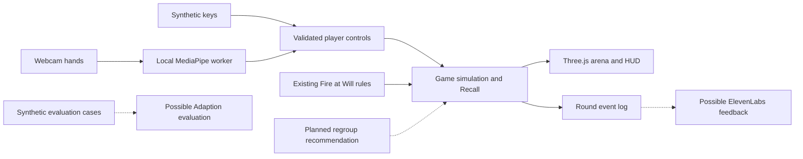

# StarshipMania team plan

## First playable demo

While the pilot steers, one in-game drone recommends regrouping and shows one clear reason. The pilot can accept or dismiss. Recall takes priority and clears any pending acceptance. Use one local rule and a repeatable Synthetic Rehearsal scenario.

At scope lock, give everyone two minutes to propose the trigger. Compare separation from the pilot and a blocked route on player value, explainability and repeatability. Boyong breaks ties. Write down the trigger and its threshold or condition, the exact demo input, the result of accept, dismiss and Recall, and which files each person owns. Agree the HUD inputs and callbacks before the two coders begin. Keep this decision in the team task and tell Control Tower which milestone it unlocks.

| Owner | First deliverable |
| --- | --- |
| **Boyong · manager and main coder** | Own gameplay, shared wiring and merges. Integrate the rule and HUD. Preserve existing steering and manual Recall. |
| **UI coder · name pending** | Use Figma Make with example data. Design pending, accepted, dismissed and recalled states. Share the prototype link, then port one keyboard-accessible HUD panel in a focused PR. |
| **Gameplay helper · name pending** | Implement the selected regroup rule and focused tests in an isolated module with an agreed interface. Boyong integrates the module. |
| **QA and demo · name pending** | Run the game from a clean checkout, review the exact revision independently, and own the two-minute recording and backup. |

Each teammate gives Boyong one relevant example of work, availability, and whether they can access GitHub, open the agreed tools and run the game. Pair on the first setup if needed. Assign one writer to shared code. Boyong owns changes to the input wiring and simulation loop.

## Programme · London time

| Target | Outcome |
| --- | --- |
| Sat 15:15–15:35 | Agree demo trigger and acceptance criteria. Confirm access, files and owners. Review the readiness PR before branching if time permits. |
| Sat 15:35–17:45 | Build the rule and HUD in parallel. QA sets up a clean checkout and writes the repeatable demo steps. |
| Sat 17:45–19:00 | Integrate and run a full scenario. If late, trim to one readable panel and keep Recall and recording time. |
| Sat 19:45–20:45 | Fix blocking issues and record a backup on the known-good build. |
| Sun 10:00 | Freeze and rehearse clean `main`. Verify the video and links. |
| Sun 11:00 | Boyong submits and checks the receipt if the entry package is ready. |
| Sun 12:00 | Official submission cutoff. [Event rules](https://imperial-ai-hackathon.devpost.com/rules) |

## From a first change to a merge

### 1. Run the game

Install Git and Node.js 24 if needed, sign into GitHub, then use PowerShell. Each teammate runs their own preview.

```powershell
git clone https://github.com/Capitano00/StarshipMania.git
cd StarshipMania
npm.cmd ci --ignore-scripts
npm.cmd run build
npm.cmd run preview
```

Open [http://127.0.0.1:4180/](http://127.0.0.1:4180/). Choose **Synthetic Rehearsal**, **Check both hands**, then **Test controls** or **Enter arena** and follow the on-screen instructions. Use `Ctrl+C` in the preview terminal before restarting it. In regular testing, keep the camera off. If a tooling permission error prevents tests from starting inside Codex, try the same command in normal PowerShell.

### 2. Take a small task

Boyong supplies the visible outcome, expected behaviour and files the author may edit. Review the existing readiness PR together before starting if time permits. If it is still pending at build time, branch from current `main` and hold the readiness PR until after integration. Open the guide from PR #1 in GitHub if it is not in your checkout yet.

```powershell
git switch main
git pull --ff-only
git switch -c codex/name-task
```

Replace `name-task` with your name and task. Give Codex or Claude Code these instructions in your checkout:

> Read AGENTS.md and the team guide, which is linked in PR #1. Work on this branch. Task: [one visible change]. Edit only [agreed files]. Show the diff, run the build and relevant checks, and explain what I should verify in the browser. Stop before committing if any check fails or a shared interface must change.

Use one assistant as writer per branch. The UI owner can use Figma Make to experiment with mock states, then port the approved panel into the existing game. Boyong handles the shared wiring. Keep credentials, recordings, camera captures and model files out of the repository.

### 3. Review, save and share

Run `git status --short` and `git diff`. Check the actual code, then run `npm.cmd run build`, `npm.cmd test -- tests/v043.test.ts` for the existing control regression case, any directly affected tests, and the browser scenario. PR #1 recorded the same 71 inherited failures on base and candidate. For a full-suite comparison, compare failure names and investigate new or changed failures.

```powershell
git add -- path/to/changed-file
git diff --cached
git commit -m "Describe the visible change"
git push -u origin HEAD
```

Replace the sample file path with the actual files. A commit saves a local checkpoint. Pushing uploads the branch. Open a pull request against `main` on GitHub and include the outcome, changed files, exact run steps, test results, known limitations and whether the project code map is affected. The team pushes task branches and uses PRs for changes to `main`.

### 4. Review again and verify the merged game

A second person opens **Files changed** and checks that the change matches the task. Run the PR in a clean review checkout using the exact commit shown in the PR. For example, for PR 1, ensure the checkout is clean first, then run `git fetch origin refs/pull/1/head`, `git switch --detach FETCH_HEAD` and `git rev-parse --short HEAD`. Verify the commit and repeat the install if the lockfile changed. Build and play the change. Report a failure with steps, expected result and actual result. The author fixes it on the same branch and asks for another review after pushing. A teammate also reviews Boyong’s changes.

Boyong uses **Squash and merge** after independent review. QA switches back to `main`, runs `git pull --ff-only`, rebuilds and repeats the demo on the merged commit. If it regresses, Boyong uses the last verified build for rehearsal and prepares a revert PR.

### Demo acceptance

- Move while the recommendation and reason appear.
- Accept and observe the agreed regroup outcome. In a fresh run, dismiss and verify the recommendation does not issue an order.
- Press **R** with the recommendation pending and again after acceptance in a separate run. Recall takes priority. A stale acceptance cannot reactivate the recommendation.
- Retry clears the previous recommendation. The full sequence works with the camera off and no sponsor credentials.
- Record the tested commit, steps, expected and actual results. Check that the judge-facing code and video links open and that Devpost shows a receipt once Boyong submits. Preserve attribution in [PROVENANCE.md](PROVENANCE.md) and [THIRD_PARTY.md](THIRD_PARTY.md).

## Code map

Baseline checked at [`af1efff`](https://github.com/Capitano00/StarshipMania/tree/af1efff0a939a5799715e09eb295896653675542).



| Area | What the code does |
| --- | --- |
| Browser and HUD | [`index.html`](index.html) starts [`src/main.ts`](src/main.ts). Main wires the UI and inputs into the simulation. [`src/view.ts`](src/view.ts) renders the Three.js scene. Display styling lives in [`src/style.css`](src/style.css). |
| Hand input | [`src/camera.ts`](src/camera.ts) captures video only if the player chooses webcam. [`public/tracking-worker.js`](public/tracking-worker.js) uses the local MediaPipe Gesture Recognizer. [`src/controls.ts`](src/controls.ts) validates observations. [`src/gestures.ts`](src/gestures.ts) defines default hand bindings for move, aim, fire, Deploy and Recall. |
| Rehearsal | [`src/main.ts`](src/main.ts) converts keyboard input into synthetic observations and feeds the same controls. This exercises software behaviour with camera and gesture model off. |
| Drone authority | [`src/simulation.ts`](src/simulation.ts) uses deterministic Fire at Will rules A/B. They choose reachable targets by distance to the mech or each drone. Accepted manual orders disable Fire at Will, and Recall takes priority. There is no runtime LLM or new regroup agent in this baseline. |
| Voice and evaluation | [`src/security.ts`](src/security.ts) disables microphone. The game has no voice input or ElevenLabs or Adaption integration. [`src/round-events.ts`](src/round-events.ts) logs semantic game events and is a candidate hook for spoken feedback. |

**Optional after core QA:** ElevenLabs can explain the recommendation. If the team tries a real-time voice agent, accept and dismiss remain proposals validated by the local game. Keep steering, Recall and keyboard fallback local. Adaption is a separate evaluation option. Spend at most 30 minutes checking leaderboard access, task fit, synthetic data needs, turnaround and artefacts. Compare base and adapted models on the same held-out cases only if a qualifying run fits the schedule. [ElevenLabs docs](https://elevenlabs.io/docs/overview/intro) · [Adaption evaluation](https://docs.adaptionlabs.ai/autoscientist/interpreting-results/)

**Map maintenance:** A PR author flags changes to inputs, authority, HUD wiring or integrations. After that change merges, Boyong or Control Tower asks the Code Structure agent to check the merged commit and return updated paths, behavior and verification gaps. The map update follows the normal PR review.
